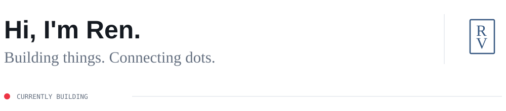
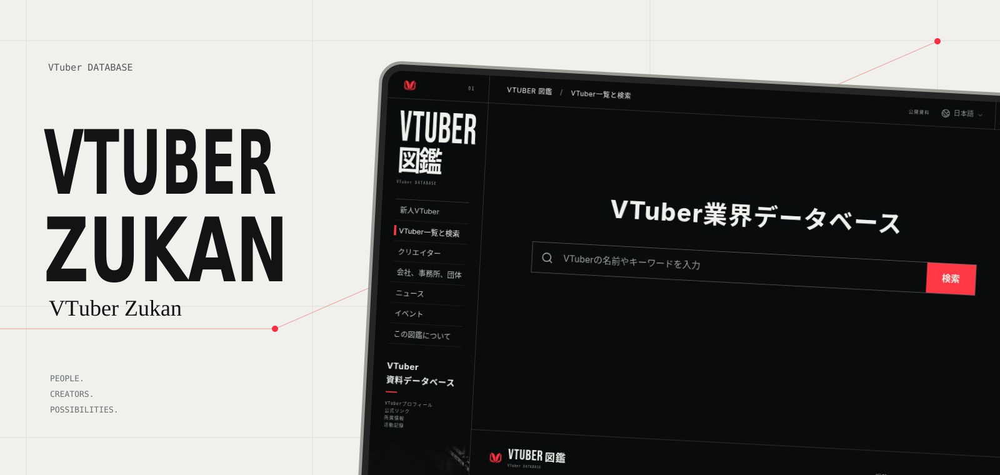

<picture>
  <source media="(prefers-color-scheme: dark)" srcset="./assets/intro-dark.svg">
  <source media="(prefers-color-scheme: light)" srcset="./assets/intro-light.svg">
  
</picture>

## A map of VTubers and their creators.

VTuber Zukan connects virtual worlds with the people behind them.

**[Explore VTuber Zukan ↗](https://vtuberzukan.com)**

 

---

FIND ME ELSEWHERE

[X / @renvalenotes](https://x.com/renvalenotes) &nbsp; · &nbsp; [note / renvalenotes](https://note.com/renvalenotes)
